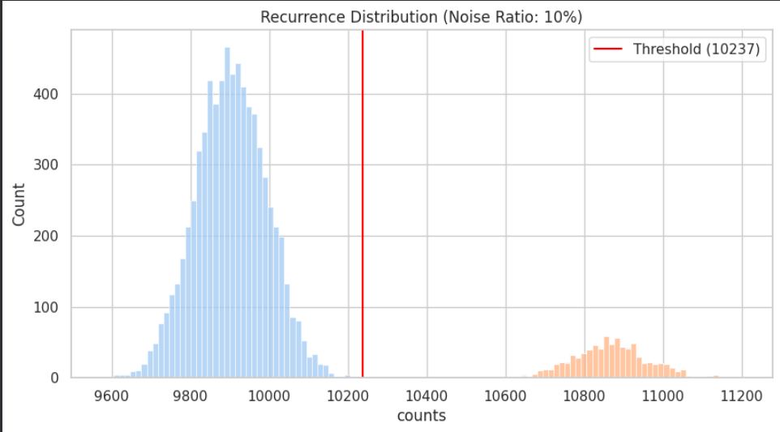
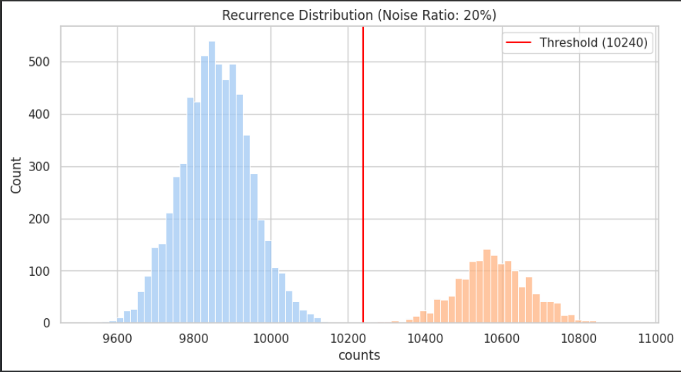

# Noisy Label Detection & Mitigation: The ReCoV Approach

## Overview

Label noise—originating from sensor malfunctions or human annotation errors—is a pervasive bottleneck in machine learning. Statistical analyses reveal that even gold-standard benchmark datasets (e.g., ImageNet) contain up to 6% noise. Counterintuitively, this noise disproportionately degrades higher-capacity models; for instance, complex architectures like ResNet-50 or VGG-19 often fail faster than their simpler counterparts (ResNet-18, VGG-11) when exposed to real-world label corruption. 

This repository serves as an experimental lab to explore modern research paradigms for handling complex noise types—specifically Instance-Dependent Noise (IDN) and Annotation Noise caused by inter-observer variability. It culminates in the implementation of the **ReCoV (Repeated Cross-Validations)** algorithm to empirically detect and isolate corrupted data points.

## Literature Taxonomy

Before implementation, I synthesized recent research (2024-2026) to categorize state-of-the-art noise-handling methods based on their intervention stage in the data pipeline:

1. **Preprocessing and Filter-Based Approach:**
   Focuses on isolating and purging noise before the training phase to maintain "clean repositories."
   *Key Papers: [Detecting noisy labels with repeated cross-validations](https://arxiv.org/html/2306.13990v2) | [KAIROS: Scalable Model-Agnostic Data Valuation](https://arxiv.org/abs/2506.23799)*

2. **In-Processing and Robust Training Approach:**
   Refuses to delete data upfront, instead dynamically handling noise during training using memory or temporal mechanisms.
   *Key Papers: [ChronoSelect: Robust Learning with Noisy Labels](https://arxiv.org/abs/2507.18183) | [Label Noise Correction via Fuzzy Learning](https://ojs.aaai.org/index.php/AAAI/article/view/34055)*

3. **Probabilistic & Generative Reconstruction Approach:**
   Learns the underlying distribution of clean data to reconstruct labels dynamically.
   *Key Papers: [Dynamic Multiple High-order Correlations Fusion](https://www.ijcai.org/proceedings/2025/0703.pdf)*

## The ReCoV Approach (Implementation)

Based on the literature, I focused on implementing **ReCoV**, a model-agnostic and parameter-free algorithm designed for complex, high-disagreement datasets (such as medical imaging and survival analysis like the HECKTOR dataset).

**Core Concept & Mathematical Mechanism:**
Traditionally, performance variance across cross-validation folds is dismissed as random initialization noise. ReCoV flips this assumption: it posits that the *worst-performing fold* inherently contains the highest concentration of mislabeled data. 

By executing massive repeated cross-validations (Monte-Carlo simulations) with different random seeds, the algorithm tracks how often a specific sample lands in the worst-performing fold. Over time, the frequencies of clean and noisy samples separate into distinct statistical distributions (modeled via Hypergeometric and Binomial distributions). 
* **Clean Samples:** Appear randomly with low frequency in the worst folds.
* **Noisy Samples:** Consistently accumulate and spike in the worst folds.

This pure statistical separation allows ReCoV to detect corrupted labels with extreme precision (achieving 100% retrieval on datasets like Mushroom at 20% noise) without relying on complex, over-engineered deep learning architectures.

## Dataset

This experiment was conducted using the **Mushroom Dataset**, a standard benchmark for classification tasks involving categorical data. 
* **Dataset Link:** [UCI Machine Learning Repository - Mushroom Dataset](https://archive.ics.uci.edu/dataset/73/mushroom) *(Update this link if you hosted the data elsewhere).*

## Experimental Setup & Execution

To rigorously test the ReCoV algorithm, I injected synthetic label noise into the dataset at two different ratios (10% and 20%). The experiment utilized multiprocessing to handle the massive computational load required by the Monte-Carlo simulations:
* **Execution:** 50,000 repeated cross-validation runs per experiment.
* **Compute Infrastructure:** Parallel execution utilizing 12 CPU cores.

## Replication Results & Benchmarks

By implementing the ReCoV logic from scratch, I successfully replicated the core findings of the original paper. The algorithm's ability to statistically separate clean samples from noisy samples is mathematically evident in the generated recurrence distributions.

### 1. Noise Ratio: 10%

* **Injected Noise:** 812 corrupted samples.
* **Detected Noise (NEP):** 812 / 812.
* **Precision:** 100%.
* **Analysis:** The recurrence distribution shows a mathematically perfect separation between clean and noisy samples at the calculated threshold (10237). The model accurately pinpointed every single corrupted label.

### 2. Noise Ratio: 20%

* **Injected Noise:** 1624 corrupted samples.
* **Detected Noise (NEP):** 1623 / 1624.
* **Precision:** ~99.93%.
* **Analysis:** Even with doubled noise corruption, the algorithm maintained robust statistical separation at the threshold (10240). It successfully isolated the corrupted labels without over-purging clean data, maintaining an Accuracy and AUC of 1.000 across final evaluations.

